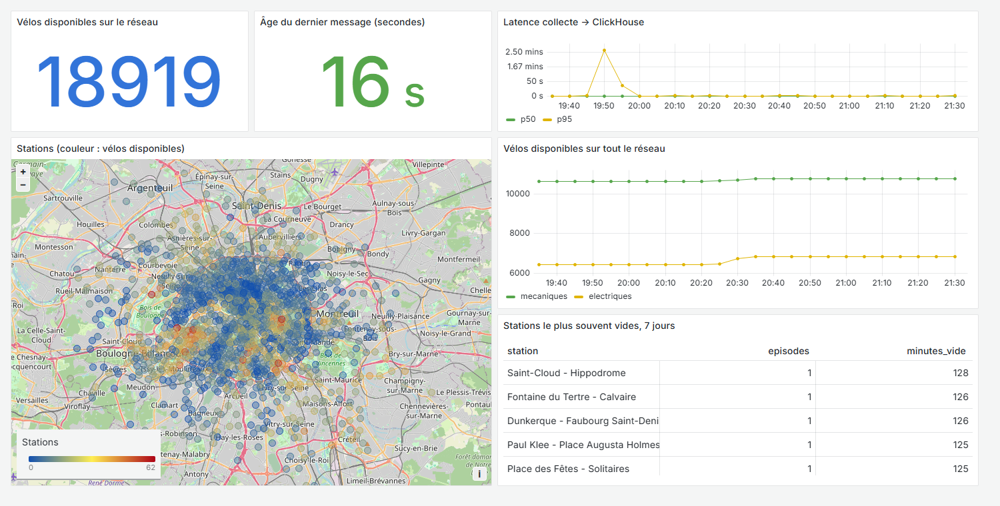
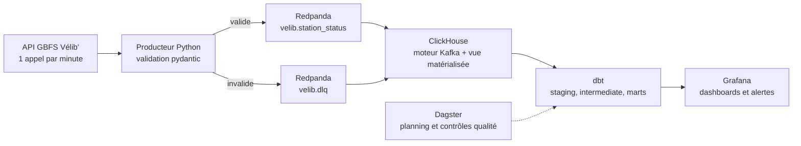

# VéliStream

**De la collecte du flux Vélib' à ClickHouse en 2 secondes au p95, sans perte de message pendant une panne de 3 minutes de la base, mesuré sur le vrai flux.**

Pipeline de données en continu sur les stations Vélib' Métropole : collecte, ingestion en streaming, stockage, transformations, orchestration, supervision et alertes. Le tout démarre avec une seule commande.




*Capture réelle du dashboard, à l'heure de Paris. Le pic de latence vers 19h50 correspond à la panne provoquée pour le test.*

## L'architecture



## Ce qui a été mesuré

Sur une session d'environ 2 heures, le 1er novembre 2026, sur une seule machine. **Je n'ai pas fait tourner le pipeline 7 jours** : sa disponibilité dans la durée reste à mesurer.

| Mesure | Résultat |
|---|---:|
| Messages ingérés | 176 320, sur 116 cycles de collecte |
| Latence de la collecte à ClickHouse, p50 | 1 s |
| Latence de la collecte à ClickHouse, p95 | 2 s |
| Démarrage à froid, de zéro aux marts remplis | 151 et 252 s, sur deux essais |
| Résolution de la latence | 1 s |

La latence jusqu'aux **marts** dépend surtout du planning dbt, lancé toutes les 5 minutes. C'est aussi ce qui explique l'écart entre les deux démarrages à froid.

### Trois tests en conditions réelles

Heures en UTC.

**Panne de la base : aucun message perdu.** ClickHouse est arrêté pendant 3 minutes alors que la collecte continue. Les 3 cycles attendent dans Redpanda et arrivent complets au redémarrage, puis la latence revient à 1 seconde :

| Cycle collecté à | Messages | Ingéré à | Délai |
|---|---:|---:|---:|
| 18:52:20, avant la panne | 1 520 | 18:52:21 | 1 s |
| 18:53:20, pendant | 1 520 | 18:55:57 | 157 s |
| 18:54:20, pendant | 1 520 | 18:55:57 | 97 s |
| 18:55:20, pendant | 1 520 | 18:55:57 | 37 s |
| 18:56:20, après | 1 520 | 18:56:21 | 1 s |

**Pipeline figé : l'alerte se déclenche.** Producteur arrêté à 20:04:09, alerte Grafana active à 20:09:14, puis retour à la normale tout seul après le redémarrage.

**Données invalides : la DLQ a servi pour de vrai.** À 18:36:13, sans aucune intervention de ma part, le flux officiel a renvoyé pour les 1 520 stations un `stationCode` à `null` et des types de vélos vides. Le cycle entier est parti en DLQ et n'a pas pollué les données. Une règle de plus rejette désormais les types de vélos qui ne somment pas au total annoncé. Elle ne fait aucun faux rejet sur 1 541 statuts réels.

### Le flux n'est pas à la minute

C'est le résultat le plus utile de ce projet. Le pipeline réagit à la seconde, mais **sa source publie bien plus lentement** :

- environ 1 540 nouveaux statuts par heure, pour environ 1 500 stations, soit à peu près un par station et par heure ;
- le dernier statut d'une station a en médiane 60 minutes d'âge, et 66 minutes au p95 ;
- le flux annonce lui-même un `ttl` de 3 600 secondes.

Ces chiffres valent pour la soirée de la mesure. Conséquences concrètes :

- Les « temps réel » de cette chaîne concernent la **tuyauterie**, pas la disponibilité des vélos à la minute près.
- La durée d'un épisode de station vide n'est précise qu'à l'heure environ.
- La plupart des messages sont des répétitions, absorbées sans doublon. Publier uniquement les changements serait une optimisation évidente, mais je garde tout pour pouvoir mesurer la latence à chaque cycle.

## Les règles d'ingénierie

- **Idempotence.** La clé logique est `(station_id, last_reported)`. `ReplacingMergeTree` fusionne en arrière-plan, sans garantie de délai : la couche staging dédoublonne donc aussi à la lecture. Un test dbt et une vérification en CI le contrôlent.
- **Pas de perte.** Rétention de 48 heures dans Redpanda, reprises avec backoff exponentiel et jitter côté producteur.
- **Validation.** Chaque message passe par pydantic avant envoi.
- **Respect de la source.** Pas plus d'un appel par minute et par flux, et le producteur refuse un intervalle plus court.
- **Temps.** Stockage en UTC, affichage en Europe/Paris.

Deux pièges rencontrés en route, tous deux détectés par les mesures :

- `now64()` reste figé pendant tout un flux Kafka de ClickHouse. Il donnait des latences négatives. Seul `nowInBlock()` donne l'heure réelle du traitement.
- `raw_station_status` fusionne les répétitions, donc elle ne peut pas prouver l'absence de perte. Le journal `ingest_log` compte ce qui est réellement reçu, cycle par cycle.

## Marts et contrôles

| Mart | Contenu |
|---|---|
| `mart_station_hourly` | Disponibilité moyenne, minimale et maximale par station et par heure |
| `mart_station_empty_full` | Épisodes de station vide ou pleine : début, fin, durée |
| `mart_network_kpis` | État de tout le réseau toutes les 5 minutes, chaque station avec son dernier statut connu |
| `mart_pipeline_health` | Volumes et latence de collecte |

Contrôles Dagster : fraîcheur, stations manquantes, vélos au-dessus de la capacité. `dbt build` donne 15 réussites et 1 avertissement : ce dernier est réel, le flux annonce parfois plus de vélos que de places, par exemple 33 vélos pour 25 places.

## Démarrage

```bash
docker compose up -d --build
```

Après environ 5 minutes, le temps du premier passage de dbt :

| Service | Adresse |
|---|---|
| Grafana | http://localhost:3001 |
| Dagster | http://localhost:3000 |

Pour le développement :

```bash
uv sync
uv run pytest -q && uv run ruff check .
```

La CI lance aussi `dbt build` sur un ClickHouse éphémère, avec un petit jeu de données fictif, puis vérifie le contenu des marts.

```
producer/              collecte, validation, reprises, métriques
clickhouse/init/       tables, moteur Kafka, vues matérialisées
dbt/                   staging, intermediate, marts, tests
orchestration/         définitions Dagster
grafana/provisioning/  source de données, dashboard, alertes
tests/                 tests unitaires et données de CI
docs/adr/              décisions d'architecture
```

Décisions documentées : [Redpanda plutôt que Kafka](docs/adr/0001-redpanda.md), [ClickHouse plutôt que Postgres ou Timescale](docs/adr/0002-clickhouse.md), [Dagster plutôt qu'Airflow](docs/adr/0003-dagster.md).

## Limites

- **Deux heures de mesure.** Pas de disponibilité sur 7 jours, pas de volume quotidien mesuré, et un seul soir d'observation du flux.
- **Mono-nœud.** Redpanda et ClickHouse tournent chacun sur un nœud. La tolérance couvre une panne de ClickHouse, pas celle de Redpanda ni de la machine.
- **Marts reconstruits en entier.** Ça convient à ce volume, mais `mart_network_kpis` devrait passer en incrémental pour durer.
- **Superposition des pannes non testée.** Par exemple, une panne de Redpanda pendant une reprise.
- **Dagster en mode développement** : suffisant ici, mais pas une configuration de production.

## Source

Données ouvertes [Vélib' Métropole](https://www.velib-metropole.fr/donnees-open-data-gbfs-du-service-velib-metropole), flux GBFS, sous licence ouverte.

## Licence

MIT
